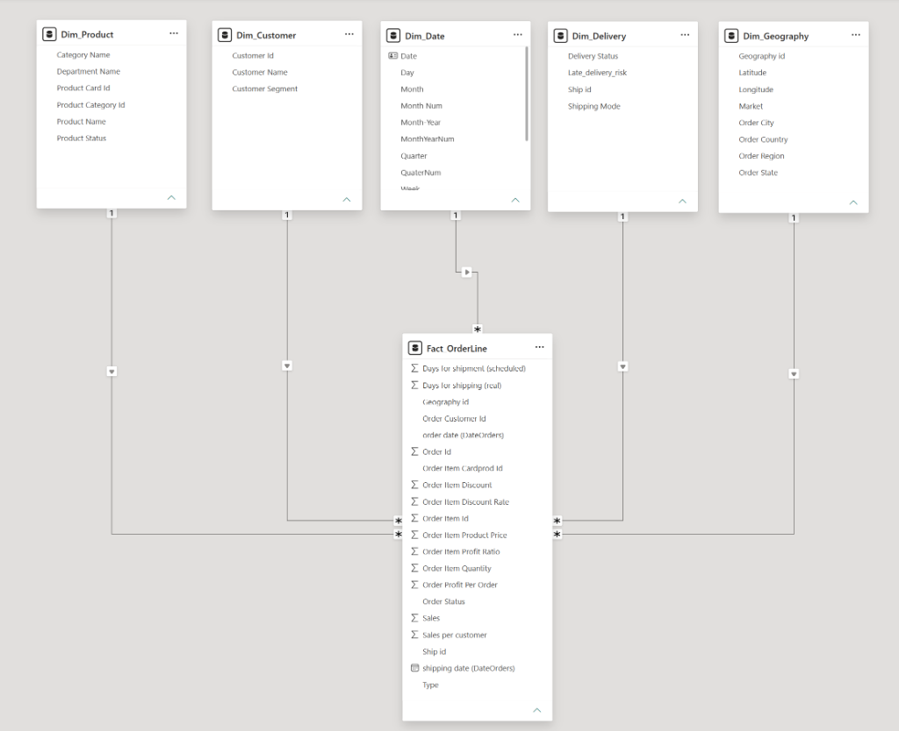
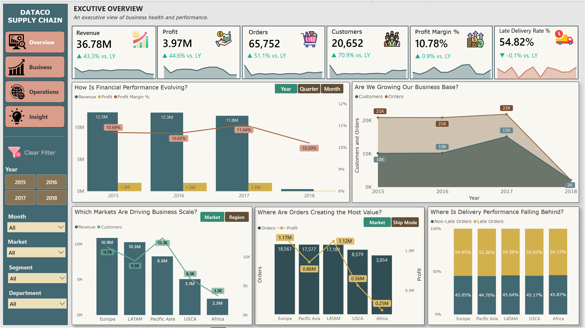
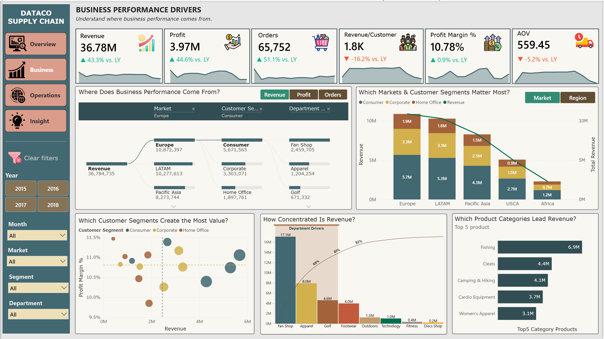
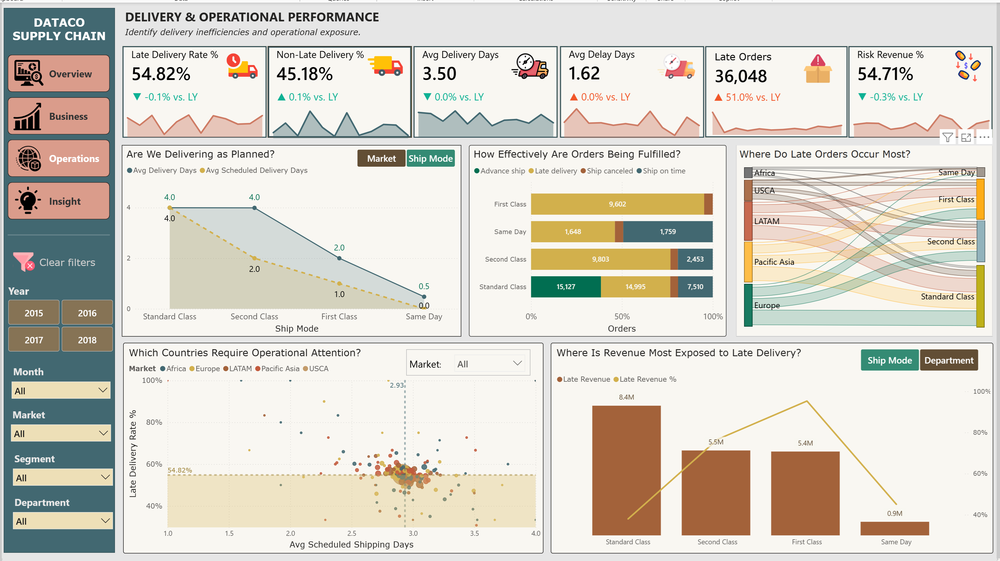
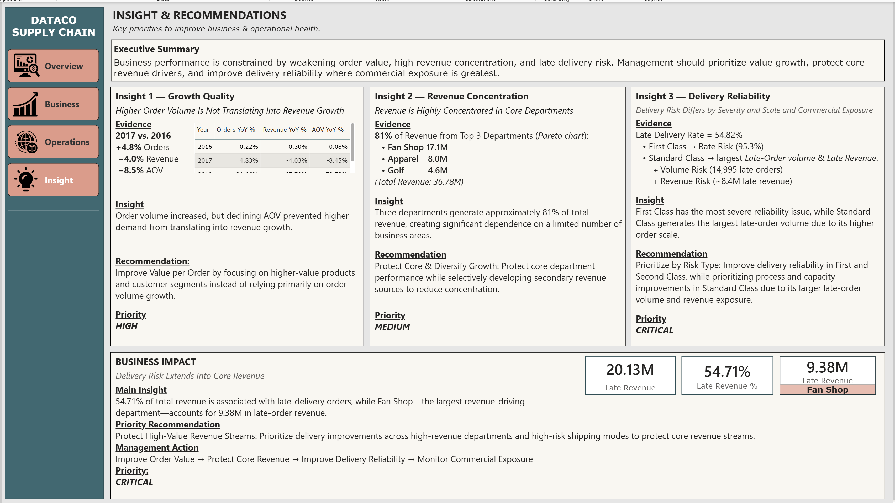

# 🌐 DataCo Smart Supply Chain & Operations Intelligence

> **An enterprise-grade Operations Control Tower dashboard designed for the Chief Operations Officer (COO) to evaluate global supply chain health, resolve late-delivery bottlenecks, address revenue concentration, and restore order profitability.**

---

## 📌 Table of Contents
1. [Background & Business Context](#-1-background--overview)
2. [Design Thinking Process](#-2-design-thinking-process)
3. [Data Description & Modeling](#-3-data-description--modeling)
4. [Dashboard Architecture & Visuals](#-4-dashboard-architecture--visuals)
5. [In-Depth Business Insights & Evidence](#-5-in-depth-business-insights--evidence)
6. [Prioritized Recommendations](#-6-prioritized-recommendations)
7. [Author & Contact](#-7-author--contact)

---

## 🏢 1. Background & Overview

Global supply chain operations require balancing two competing mandates: **commercial growth** and **operational fulfillment reliability**. When logistics SLAs degrade, customer lifetime value declines and hard-won market share is rapidly eroded.

This project delivers a **comprehensive Operations Control Tower** built for the **Chief Operations Officer (COO)** of DataCo Global. Leveraging an enterprise transactional dataset of **180,519 records** across global territories (LATAM, Europe, USCA, Pacific Asia, Africa), the solution establishes unified visibility across order processing, logistics lead times, delivery fulfillment, and product margin performance.

### 🌟 Headline Findings:
* **Total Business Scale:** **\$36.78M Total Revenue** and **\$3.98M Profit** across 65,000+ customer orders.
* **The Growth Quality Paradox (2017 vs. 2016):** While order volume grew by **+4.8%**, overall revenue dropped by **−4.0%** because Average Order Value (AOV) plummeted by **−8.5%**.
* **High Revenue Concentration:** **81% of total global revenue** is concentrated in just 3 departments (*Fan Shop \$17.1M, Apparel \$8.0M, Golf \$4.6M*).
* **Delivery Reliability Crisis:** **54.82% of all orders are delivered late**, exposing **54.71% of total gross revenue** (~$20M+) to severe customer dissatisfaction risk.
* **Dual-Risk Logistics Profile:**
  * **Rate Risk (Severity):** *First Class* has a staggering **95.3% late delivery rate**.
  * **Scale Risk (Volume & Commercial Exposure):** *Standard Class* accounts for the largest late-order volume (**14,995 orders**) and the highest late revenue exposure (**~$8.4M**).

---

### 🎯 Business Problem & Strategic Context

### Core Business Questions Answered:
1. *Is company top-line expansion translating into healthy, profitable growth?*
2. *Where do revenue and profitability originate, and how concentrated is commercial risk?*
3. *Which shipping modes and geographic regions represent operational bottlenecks?*
4. *How does delivery delay extend into core commercial revenue streams, and what actions should the executive committee prioritize?*

---

### 🧠 2. Design Thinking Process

#### Stage 1: Empathize (5W1H)

#### Stage 2: Define Point of View

#### Stage 3: Ideate

#### 
---
## 📖 3. Data Description & Modeling
The original flat table (180k rows × 53 columns) was normalized into an enterprise **Star Schema** to ensure high DAX evaluation speed and intuitive report navigation:

### 3.1. Data Source & Scale
- **Source**: [DataCo Smart Supply Chain for Big Data Analysis](https://www.kaggle.com/datasets/shashwatwork/dataco-smart-supply-chain-for-big-data-analysis) dataset on Kaggle.
- **Scale**: **180,519 transactional records** with 53 raw attributes spanning from **January 2015 through January 2018**.
- **Scope**: Covers the end-to-end commercial supply chain lifecycle: omnichannel sales transactions, customer demographics, multi-tier product catalog hierarchy, 5 global macro trade markets, logistics shipping modes, and SLA delivery tracking.
  
### 3.2. Data Modeling (Star Schema)

To eliminate data redundancy, prevent circular relationship paths, and optimize DAX calculation performance, the flat transaction dataset was transformed in Power Query into an enterprise **Star Schema (1 Fact Table + 5 Dimension Tables)**. All relationships maintain **1-to-Many (`1:*`) cardinality** with **Single Cross-Filter Direction** flowing strictly from Dimensions down to the Fact table:

#### 📌 Star Schema Table Architecture

| Table Name | Type | Granularity | Role & Relationship Key |
| :--- | :---: | :--- | :--- |
| **`Fact OrderLine`** | **Fact** | 1 row per ordered product item (`Order Item Id`) | Central transaction fact capturing financial metrics, order quantities, transit days, and fulfillment statuses. Joins to all 5 dimension tables on surrogate/natural foreign keys. |
| **`Dim_Product`** | **Dimension** | 1 row per unique product SKU (`Product Card Id`) | Catalogs product specifications, merchandise category, department, and stock status. Joins to Fact on `Product Card Id` = `Order Item Cardprod Id`. |
| **`Dim_Customer`** | **Dimension** | 1 row per unique customer (`Customer Id`) | Stores customer profile, full name, and market segment. Joins to Fact on `Customer Id` = `Order Customer Id`. |
| **`Dim_Date`** | **Dimension** | 1 row per calendar day (`Date`) | Governs Time Intelligence logic (YoY, MoM, YTD) across fiscal hierarchies. Joins to Fact on `Date` = `order date (DateOrders)`. |
| **`Dim_Delivery`** | **Dimension** | 1 row per shipping profile (`Ship id`) | Defines shipping mode, carrier SLA delivery status, and late delivery risk. Joins to Fact on `Ship id` = `Ship id`. |
| **`Dim_Geography`** | **Dimension** | 1 row per destination profile (`Geography id`) | Establishes regional hierarchies (City → State → Country → Region → Market) and GPS coordinates. Joins to Fact on `Geography id` = `Geography id`. |

---
### 3.3. Table Data Dictionary

     
 <b>1. Fact Table: Fact_OrderLine</b>

*Contains 180,519 transactional line items spanning global operations.*

| Field Name | Data Type | Key | Description from `DescriptionDataCoSupplyChain.csv` & Business Logic |
| :--- | :---: | :---: | :--- |
| `Order Item Id` | `Integer` | **PK** | **Order item code**: Unique surrogate identifier for each distinct product item in an order. |
| `Order Id` | `Integer` | - | **Order code**: Header order identifier linking multiple item rows into one customer purchase order. |
| `Type` | `Text` | - | **Type of transaction made**: Payment method used (`DEBIT`, `TRANSFER`, `PAYMENT`, `CASH`). |
| `order date (DateOrders)` | `Date` | **FK** | **Date on which the order is made**: Purchase timestamp joining to `Dim_Date`[`Date`]. |
| `shipping date (DateOrders)` | `Date` | - | **Exact date and time of shipment**: Actual timestamp when items were dispatched. |
| `Order Customer Id` | `Integer` | **FK** | **Customer order code**: Identifier joining to `Dim_Customer`[`Customer Id`]. |
| `Order Item Cardprod Id` | `Integer` | **FK** | **Product code generated through RFID reader**: Identifier joining to `Dim_Product`[`Product Card Id`]. |
| `Ship id` | `Integer` | **FK** | **Surrogate Shipping Key**: Identifier joining to `Dim_Delivery`[`Ship id`]. |
| `Geography id` | `Integer` | **FK** | **Surrogate Location Key**: Identifier joining to `Dim_Geography`[`Geography id`]. |
| `Order Status` | `Text` | - | **Current lifecycle status of order**: `COMPLETE`, `PENDING`, `CLOSED`, `PENDING_PAYMENT`, `CANCELED`, `PROCESSING`, `SUSPECTED_FRAUD`, `ON_HOLD`, `PAYMENT_REVIEW`. |
| `Order Item Quantity` | `Integer` | - | **Number of products per order**: Total units purchased per line item. |
| `Order Item Product Price` | `Decimal` | - | **Price of products without discount**: Baseline unit retail price before promotional discount. |
| `Order Item Discount` | `Decimal` | - | **Order item discount value**: Dollar discount deducted from gross value ($ USD). |
| `Order Item Discount Rate` | `Decimal` | - | **Order item discount percentage**: Effective promotional percentage applied (0.00 – 0.25). |
| `Sales` | `Decimal` | - | **Value in sales (Sale per order)**: Net revenue realized per line item after deducting discounts ($ USD). |
| `Sales per customer` | `Decimal` | - | **Total sales made per customer**: Cumulative sales aggregated per customer account ($ USD). |
| `Order Profit Per Order` | `Decimal` | - | **Earnings per order placed (Benefit per order)**: Net operating profit generated per line item ($ USD). |
| `Order Item Profit Ratio` | `Decimal` | - | **Order Item Profit Ratio**: Profit margin ratio per line item: `[Order Profit] / [Sales]`. |
| `Days for shipping (real)` | `Integer` | - | **Actual shipping days of the purchased product**: Elapsed transit days from dispatch to delivery. |
| `Days for shipment (scheduled)` | `Integer` | - | **Days of scheduled delivery of the purchased product**: Contractually committed delivery days (SLA). |

---

     
 <b>2. Dimension Table: Dim_Product</b>

*Catalogs 118 commercial products across 50 categories and 10 executive departments.*

| Field Name | Data Type | Key | Description from `DescriptionDataCoSupplyChain.csv` & Business Logic |
| :--- | :---: | :---: | :--- |
| `Product Card Id` | `Integer` | **PK** | **Product code**: Unique RFID product code joining to `Fact OrderLine`[`Order Item Cardprod Id`]. |
| `Product Name` | `Text` | - | **Product Name**: Full commercial name of the merchandise item. |
| `Product Category Id` | `Integer` | - | **Product category code**: Numeric identifier for the product category. |
| `Category Name` | `Text` | - | **Description of product category**: Sub-category name (*Cleats, Men's Footwear, Cardio Equipment, Women's Apparel...*). |
| `Department Name` | `Text` | - | **Department name of store**: Business department (*Fan Shop, Apparel, Golf, Footwear, Outdoors, Fitness...*). |
| `Product Status` | `Integer` | - | **Status of product stock**: Inventory availability flag (`0` = Product is available, `1` = Not available / Discontinued). |

---

     
 <b>3. Dimension Table: Dim_Customer</b>

*Manages customer identity and behavioral segmentation across 20,652 unique accounts.*

| Field Name | Data Type | Key | Description from `DescriptionDataCoSupplyChain.csv` & Business Logic |
| :--- | :---: | :---: | :--- |
| `Customer Id` | `Integer` | **PK** | **Customer ID**: Unique customer identification number joining to `Fact OrderLine`[`Order Customer Id`]. |
| `Customer Name` | `Text` | - | **Customer Name**: Full name derived from customer first name (`Customer Fname`) and last name (`Customer Lname`). |
| `Customer Segment` | `Text` | - | **Types of Customers**: Customer market classification: *Consumer* (52%), *Corporate* (30%), or *Home Office* (18%). |

---

     
 <b>4. Dimension Table: Dim_Date</b>

*Dedicated calendar dimension supporting Time Intelligence calculations.*

| Field Name | Data Type | Key | Description & Business Logic |
| :--- | :---: | :---: | :--- |
| `Date` | `Date` | **PK** | **Calendar Date**: Continuous daily dates (`YYYY-MM-DD`) joining to `Fact OrderLine`[`order date (DateOrders)`]. |
| `Day` | `Integer` | - | **Day of the month**: Day number ranging from 1 to 31. |
| `Month` | `Text` | - | **Month Name**: Full name of the month (*January, February, March...*). |
| `Month Num` | `Integer` | - | **Month Number**: Sequential month number from 1 to 12. |
| `Month-Year` | `Text` | - | **Month and Year**: Standard reporting string (e.g., `Jan 2016`, `Jul 2017`). |
| `MonthYearNum` | `Integer` | - | **Month-Year Sort Key**: Integer key used to sort chronological displays correctly (`YYYYMM`, e.g., `201601`). |
| `Quarter` | `Text` | - | **Quarter**: Fiscal quarter string (*Q1, Q2, Q3, Q4*). |
| `QuaterNum` | `Integer` | - | **Quarter Number**: Numeric fiscal quarter index from 1 to 4. |
| `Week` | `Integer` | - | **Week Number**: Numeric week of the year (1 - 53). |

---

     
 <b>5. Dimension Table: Dim_Delivery</b>

*Standardized delivery carrier modes and contractual service-level agreements (SLA).*

| Field Name | Data Type | Key | Description from `DescriptionDataCoSupplyChain.csv` & Business Logic |
| :--- | :---: | :---: | :--- |
| `Ship id` | `Integer` | **PK** | **Surrogate Shipping Key**: Unique identifier joining to `Fact OrderLine`[`Ship id`]. |
| `Shipping Mode` | `Text` | - | **Shipping modes presented**: 4 logistics carrier transit options: *Standard Class, First Class, Second Class, Same Day*. |
| `Delivery Status` | `Text` | - | **Delivery status of orders**: Categorical fulfillment state: *Late delivery, Advance shipping, Shipping on time, Shipping canceled*. |
| `Late_delivery_risk` | `Integer` | - | **Late Delivery Indicator**: Binary flag indicating SLA breach: `1` = Delivery is late (`real > scheduled`), `0` = Delivery is not late. |

---

     
 <b>6. TDimension Table: Dim_Geography</b>

*Geographic destination mapping across 5 global trade markets.*

| Field Name | Data Type | Key | Description from `DescriptionDataCoSupplyChain.csv` & Business Logic |
| :--- | :---: | :---: | :--- |
| `Geography id` | `Integer` | **PK** | **Surrogate Location Key**: Unique geographic destination key joining to `Fact OrderLine`[`Geography id`]. |
| `Order City` | `Text` | - | **Destination city of the order**: Destination city where the package is delivered. |
| `Order State` | `Text` | - | **State of region where order is delivered**: Destination administrative state or province. |
| `Order Country` | `Text` | - | **Destination country of the order**: Destination sovereign country name. |
| `Order Region` | `Text` | - | **Region of the world where order is delivered**: Specific world geographic zone (*Southeast Asia, Western Europe, South America, Central America...*). |
| `Market` | `Text` | - | **Market to where the order is delivered**: 5 global trading blocks: *Africa, Europe, LATAM, Pacific Asia, USCA*. |
| `Latitude` | `Decimal` | - | **Latitude**: Exact geographic coordinate of store/destination location. |
| `Longitude` | `Decimal` | - | **Longitude**: Exact geographic coordinate of store/destination location. |

---

## 📊 4. Dashboard Architecture & Visuals

The report comprises **4 Strategic Pages** and **Dynamic Micro-Interaction Tooltips**:

### 1. Page 1: Executive Overview
* **Purpose:** Strategic executive pulse check connecting macro financial health with operational delivery KPIs.
* **Key Visuals:**
  * **Executive KPI Cards (with YoY Variance):** Revenue, Profit, Profit Margin %, Total Orders, Customers, and Late Delivery Rate %.
  * **Financial Progression Over Time:** Monthly revenue and profit margin trajectory.
  * **Regional Business Scale:** Comparative performance across global markets (LATAM, Europe, USCA, Pacific Asia, Africa).
  * **Delivery Health Indicator:** Overall late delivery rate benchmarked against target SLAs.

*(Insert screenshot: `assets/dashboards/01_Executive_Overview.png`)*

---

### 2. Page 2: Business Performance Drivers
* **Purpose:** Discovering the fundamental drivers of revenue and assessing customer segment dynamics.
* **Key Visuals:**
  * **Pareto Concentration Chart (80/20):** Department cumulative revenue contribution highlighting structural dependence.
  * **Category Leadership Matrix:** Top-performing categories (Cleats, Men's Footwear, Women's Apparel).
  * **Customer Segment Breakdown:** Consumer (52%), Corporate (30%), and Home Office (18%) distribution across markets.

*(Insert screenshot: `assets/dashboards/02_Business_Drivers.png`)*

---

### 3. Page 3: Delivery & Operational Performance
* **Purpose:** Granular inspection of logistics lead times, carrier compliance, and bottleneck isolation.
* **Key Visuals:**
  * **Sankey Supply Chain Flow:** Mapping order flow from Origin Markets → Shipping Modes → Delivery Fulfillment Status.
  * **Dumbbell Chart (Scheduled vs. Real Days):** Visualizing the variance gap between SLA commitments and physical delivery days.
  * **Late Delivery Exposure by Shipping Mode:** Contrasting rate severity against absolute financial exposure.
  * **Geographic Risk Map:** Pinpointing recipient countries experiencing severe fulfillment lag.

*(Insert screenshot: `assets/dashboards/03_Operations_Delivery.png`)*

---

### 4. Page 4: Strategic Insights & Recommendations
* **Purpose:** Executive decision matrix synthesizing findings into actionable operational workstreams.

*(Insert screenshot: `assets/dashboards/04_Insight_Recommendations.png`)*

---

## 💡 5. In-Depth Business Insights & Evidence

### 🔍 Insight 1 — Growth Quality: Higher Volume Fails to Translate into Revenue Expansion
* **Evidence (2017 vs. 2016):**
  * Order volume expanded by **+4.8%** (higher processing burden on warehouses).
  * Net Revenue contracted by **−4.0%**.
  * Average Order Value (AOV) declined by **−8.5%**.
* **Analytical Interpretation:** The business is working harder to earn less. Processing more smaller-value baskets escalates fixed pick-and-pack logistics overhead without delivering corresponding top-line expansion.

---

### 🔍 Insight 2 — Revenue Concentration: High Commercial Exposure in Core Departments
* **Evidence (Pareto Analysis):**
  * **Top 3 Departments generate 81.0% of total revenue ($36.78M):**
    1. **Fan Shop:** **$17.1M** (46.5%)
    2. **Apparel:** **$8.0M** (21.7%)
    3. **Golf:** **$4.6M** (12.5%)
* **Analytical Interpretation:** An overwhelming portion of business enterprise value rests on Fan Shop merchandise. Any supply disruption, supplier dispute, or drop in licensing rights immediately threatens corporate solvency.

---

### 🔍 Insight 3 — Delivery Reliability: Stratification Between Severity Risk & Scale Risk
* **Evidence:**
  * Global Late Delivery Rate stands at **54.82%**.
  * **First Class (Rate / Severity Risk):** **95.3% late delivery rate**. Almost zero customer orders arrive within the promised expedited timeframe.
  * **Standard Class (Scale / Financial Risk):** Highest late volume (**14,995 late orders**) carrying **~$8.4M in late revenue exposure**.
* **Analytical Interpretation:** Premium customers who pay extra for First Class shipping experience near-total fulfillment failure (reputation damage), whereas Standard Class represents a massive operational bottleneck draining cash flow.

---

### 🔍 Insight 4 — Business Impact: Delivery Friction Extends into Core Revenue
* **Evidence:**
  * **54.71% of total enterprise revenue** is tied to orders delivered behind schedule.
  * **Fan Shop alone accounts for $9.38M in late revenue exposure.**
* **Analytical Interpretation:** Operational delivery failures are not isolated to fringe products; they are actively threatening relationships with the company's highest-spending customer cohort.

---

## 🚀 6. Prioritized Recommendations

| Priority | Strategic Initiative | Action Items | Expected Business Impact |
| :---: | :--- | :--- | :--- |
| **P1 - CRITICAL** | **Logistics SLA Restructuring (First Class)** | Audit external carrier contract agreements; recalibrate scheduled SLA promises from 1–2 days to realistic transit thresholds or replace underperforming 3PL providers. | Eliminate the 95.3% late delivery rate on expedited orders; protect high-margin premium customer satisfaction. |
| **P2 - CRITICAL** | **Standard Class Fulfillment Overhaul** | Optimize warehouse dispatch throughput; establish dedicated fast-tracking lanes for high-volume standard parcels. | Reduce late order volume by 25–30%, safeguarding ~$2.5M in annual repeat business. |
| **P3 - HIGH** | **AOV & Basket Expansion Strategy** | Introduce cross-category bundling (e.g., Fan Shop merchandise paired with Apparel items) and tiered free-shipping minimum thresholds. | Reverse the −8.5% AOV erosion, lifting total revenue without inflating operational unit costs. |
| **P4 - MEDIUM** | **Selective Portfolio Diversification** | Strategically invest marketing and distribution resources into mid-tier departments (Footwear, Outdoors) to de-risk dependency on Fan Shop. | Rebalance revenue concentration so no single department exceeds 35% of total turnover. |

---

## 👤 7. Author & Contact

* **Author:** **Nguyễn Xuân Thu**
* **Role:** Data Analyst (Specializing in Operations Analytics, Supply Chain Intelligence & BI)
* **Email:** *[thu.nx280@gmail.com]*
* **LinkedIn:** *[https://linkedin.com/]*
* **GitHub:** *[https://github.com/thunx280-ctrl]*

---
*⭐ If you find this project valuable for your supply chain analysis or evaluation, please consider starring the repository!*
